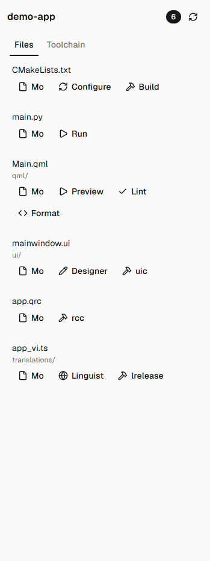

# Qt Developer Pack cho Orca

Bộ 4 plugin Orca cho dev Qt / QML / PySide6 / PyQt (Python và C++). Dùng nội bộ trong team,
**repo private, không đăng lên danh mục công khai của Orca**.

| Plugin | Loại | Cần duyệt quyền | Nội dung |
| --- | --- | --- | --- |
| **Qt Developer Syntax** (`qt-dev-syntax`) | `data` | Không | Tô màu `.qss`, `.qrc`, `.ui`, `.qtd`, `.qdoc`, `pysidedeploy.spec`, qmake (`.pro/.pri/.prf`), `.cmake`, `CMakeCache.txt`, `requirements.txt` |
| **Qt Developer Icons** (`qt-dev-icons`) | `data` | Không | Icon Material (~470 loại file) + icon Qt cho `.qml`, `.ui`, `.qrc`, `.qss`, `qmldir`, QDoc, PySide6 deploy; icon thư mục `qml/`, `ui/`, `resources/`, `translations/`… Có bản sáng và tối |
| **Qt Developer Tools** (`qt-dev-tools`) | `trusted-worker` | **Có** | Panel "Qt Tools" liệt kê file Qt của workspace với nút Designer / uic / rcc / qmllint / Preview / Format / Linguist / lrelease / CMake configure + build / qmake / Run; 8 lệnh trong Command Palette; `qmlformat` tự chạy khi lưu `.qml`; phím tắt `Ctrl+Shift+B` = CMake build |
| **Qt Code Intelligence** (`qt-dev-python-lsp`) | `trusted-worker` | **Có** | Chế độ xem **Python (LSP)**, **QML (LSP)**, **C++ (LSP)** kiểu VS Code: Ctrl+Click / F12 tới định nghĩa (import, hàm, biến, lớp Qt), rê chuột xem kiểu/tài liệu, gợi ý code, báo lỗi, tô màu theo nghĩa. Python tự chọn interpreter như VS Code |

**Cài kèm:** plugin chính thức **QML Syntax** (`stablyai.orca-qml`) từ Settings → Plugins để tô màu `.qml` và `qmldir`
trong trình soạn thảo thường của Orca.



## Cài cho thành viên team

### 1. Yêu cầu trên máy

| Cần | Dùng cho | Cài thế nào |
| --- | --- | --- |
| Orca ≥ 1.4.248, đã bật plugin (Settings → Plugins → Turn on plugins) | Tất cả | |
| Git đã đăng nhập GitHub, có quyền đọc `tungvu-vms/orca-qt-pack` | Tải marketplace | Được mời làm collaborator; `gh auth login` hoặc Git Credential Manager |
| Node.js ≥ 20 trên PATH | Python (LSP) | https://nodejs.org |
| basedpyright | Python (LSP) | `npm i --prefix "%LOCALAPPDATA%\orca-qt-lsp" basedpyright@1.40.2` |
| Qt ≥ 6.5 (có `qmlls`) dưới `C:\Qt` | QML (LSP), Qt Tools | Qt Online Installer |
| clangd | C++ (LSP) | Có sẵn khi cài **Qt Creator** (`C:\Qt\Tools\QtCreator\bin\clang\bin`), hoặc LLVM |
| `compile_commands.json` trong thư mục build | C++ (LSP) | CMake configure với `-DCMAKE_EXPORT_COMPILE_COMMANDS=ON` (nút *Configure* của Qt Tools đã bật sẵn) |

### 2. Cài plugin

1. Orca → **Settings → Plugins → Marketplaces → Add** → dán
   `https://github.com/tungvu-vms/orca-qt-pack.git`, ref `main`.
2. Trong marketplace "Qt Developer Pack (team)", cài các plugin cần dùng.
3. Plugin `trusted-worker` (Qt Tools, Code Intelligence) sẽ hỏi duyệt quyền. Duyệt thì mới chạy.
4. **Settings → Appearance → Icon theme** → *Qt Developer Icons* (hoặc bản Light).

### 3. Dùng

- **Qt Tools:** icon cờ lê ở thanh bên phải.
- **Code Intelligence:** mở file `.py` / `.qml` / `.cpp` / `.h`, ở chỗ chuyển chế độ xem cạnh **Source** chọn
  **Python (LSP)** / **QML (LSP)** / **C++ (LSP)**.
  - Thanh dưới: trạng thái server, số lỗi. Nút 🐍 (Python) đổi interpreter; nút ⚙ (QML/C++) khởi động lại server
    (bấm sau khi chạy CMake configure lần đầu).
  - Ctrl+Click sang file khác mở tab Orca ở **đầu file** (Orca chưa cho plugin chọn dòng); thanh trạng thái báo dòng.

### Cấu hình

**Qt Developer Tools:** Qt bin folder, Python binding (PySide6/PyQt6/PyQt5/C++), Python interpreter, Format QML on
save, CMake generator / build type.

**Qt Code Intelligence:** Python interpreter (để trống = tự chọn như VS Code), đường dẫn Pyright/basedpyright,
Node.js, Qt bin folder, qmlls, clangd. Để trống là tự tìm.

Interpreter Python được chọn theo thứ tự của VS Code: đã chọn tay → `.vscode/settings.json` →
`pyrightconfig`/`pyproject` → venv của dự án (venv ngay trong dự án, bản Python cao nhất) → Python cài đặt bản cao nhất.

## Phát triển

```sh
npm install                       # typescript, @types/node, vscode-textmate (kiểm tra, không nằm trong plugin)
npx tsc -p plugins/qt-tools
orca plugin test plugins/qt-tools
orca plugin check plugins/qt-tools
orca plugin validate plugins/qt-syntax
node tools/tokenize-check.mjs plugins/qt-syntax samples/*

# Qt Code Intelligence: mã nguồn ở lsp-build/src, build ra plugins/qt-lsp
cd lsp-build && npm ci --ignore-scripts && node build.mjs
orca plugin dev load plugins/qt-lsp
```

- **Đừng để gì khác vào thư mục `plugins/<tên>/`** (`node_modules`, `.d.ts`…). Orca băm toàn bộ thư mục; thêm file
  sau khi duyệt làm worker không khởi động ("content hash mismatch"). Kiểu của Orca ở `types/orca/`.
- `lsp-build/vendor/`: grammar + theme lấy từ VS Code (chạy lại `node prepare-vendor.mjs "<VS Code>\resources\app\extensions"` khi muốn cập nhật).
- `lsp-build/dev/`: script test end-to-end trên Orca thật (`e2e-worker.ps1`, `e2e-qt.ps1`, `interp-e2e.ps1`) và dự án mẫu.
- `tools/normalize-syntaxes.mjs`, `tools/build-icon-theme.mjs`: xem chú thích trong file.

### Phát hành bản mới

1. Sửa plugin, **tăng `version`** trong `orca-plugin.json` của plugin đó, commit.
2. `node tools/build-catalog.mjs --url https://github.com/tungvu-vms/orca-qt-pack.git --owner tungvu-vms`
3. Commit `orca-catalog.json`, push. Orca của team tự cập nhật (plugin `trusted-worker` thêm quyền mới sẽ hỏi duyệt lại).

## Nguồn và giấy phép

| Thành phần | Nguồn | Giấy phép |
| --- | --- | --- |
| Grammar qss, qrc, ui, qt-ts, qtd, qdoc, pysidedeploy; icon Qt | Extension Qt cho VS Code (qt-labs/vscodeext) 1.16.0 | LGPL-3.0 |
| Grammar CMake, CMakeCache | microsoft/vscode-cmake-tools 1.24.42 | MIT |
| Grammar pip-requirements | microsoft/vscode-python 2026.10.0 | MIT |
| Grammar XML, INI, Java, C/C++, theme Dark+/Light+ | microsoft/vscode | MIT |
| Grammar MagicPython | MagicStack | MIT |
| Grammar QML | seanwu1105/vscode-qt-for-python (qua stablyai/orca-plugins) | MIT |
| Monaco Editor, vscode-textmate, vscode-oniguruma | Microsoft | MIT (Oniguruma: BSD-2) |
| Icon Material + theme gốc | stablyai/orca-plugins `material-icons` | MIT |
| Grammar qmake, code của Qt Tools / Code Intelligence, các script | Tự viết | MIT |

Language server không đóng gói kèm: basedpyright (MIT), qmlls (Qt), clangd (LLVM) chạy từ máy người dùng.
